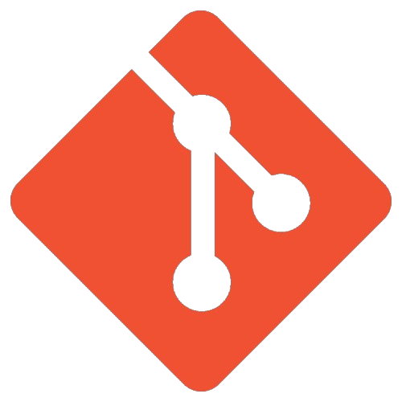
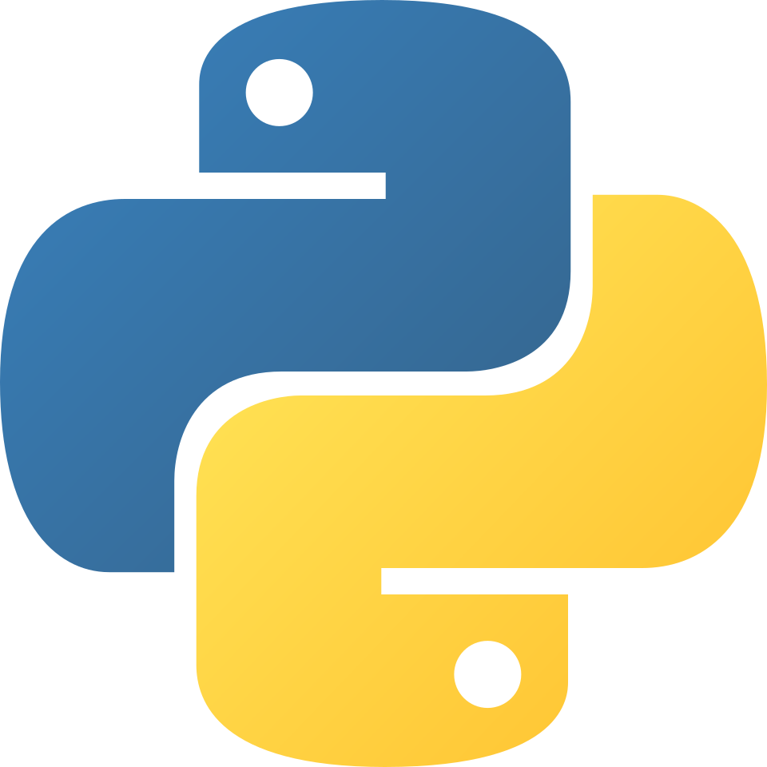
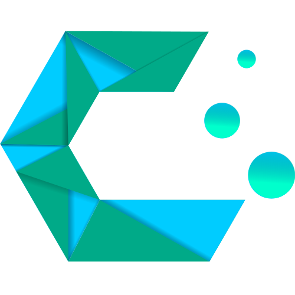

# TheMuffinman20

*"Intelligence is the ability to avoid work, yet getting the work done."* - Linus Torvalds

I'm a student at **HOGENT**, trying to learn everything there is about programming and networking.

- **How to reach me:**
    - Github: [TheMuffinman20](link)
    - Discord: [rTheMuffinman](link)
    - Outlook: [thibo.daelman@student.hogent.be](link)
- **Curent Operating system**: CachyOS (Linux)  
- **Curent Shell**: Caelestia Shell

## Toolbox

<table border>
  <thead>
    <tr>
      <th>I have</th>
      <th>I'm learning</th>
      <th>I'm using</th>
    </tr>
  </thead>
  <tbody>
    <tr>
      <td>
      
      
       
      
      
       
      
      
      </td>
      <td>
      
      
      
      </td>
      <td>
      
      
       
      
      </td>
    </tr>
  </tbody>
</table>

## Get in touch

I'm open to internships, collaboration and interesting problems.

|  |  |
|---|---|
|| **Github** · TheMuffinman20 |
|| **Discord** · rTheMuffinman |
|| **Outlook** · thibo.daelman@student.hogent.be |